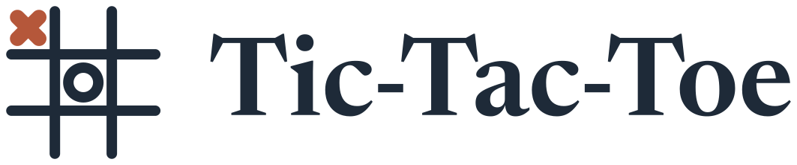
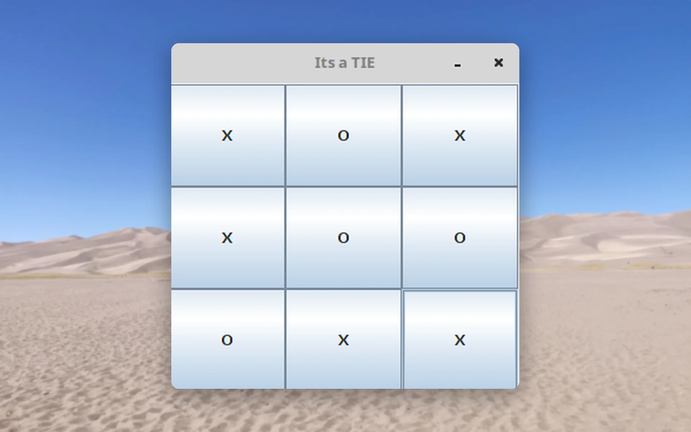
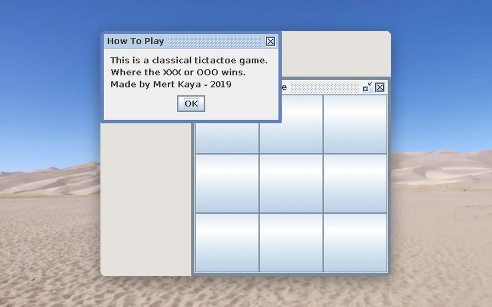
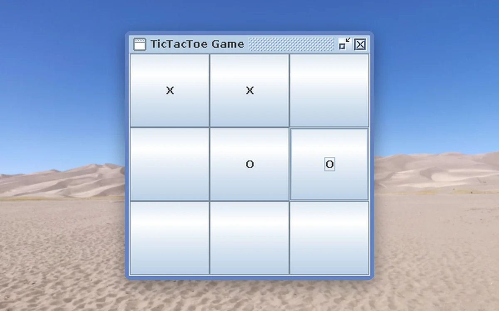
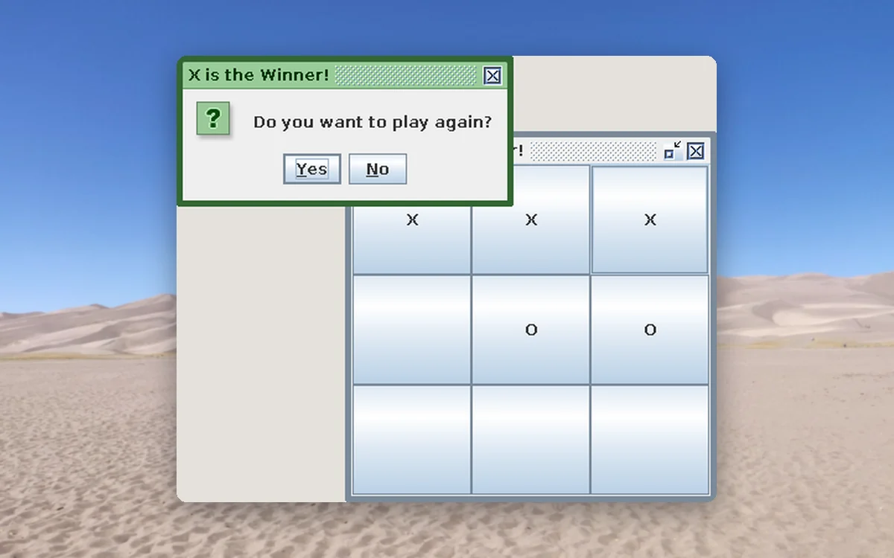
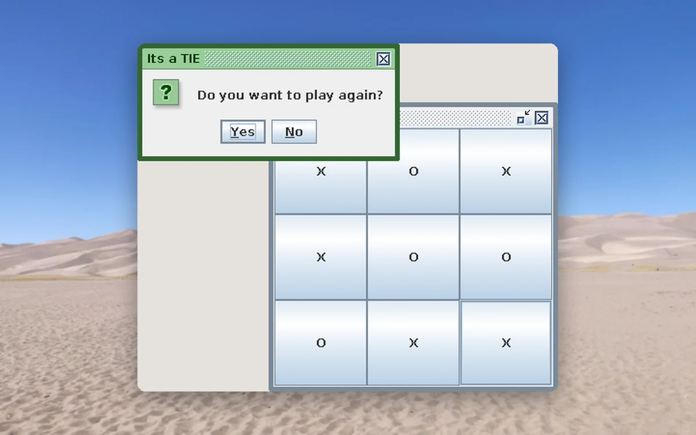

<p align="center">
  <picture>
    <source media="(prefers-color-scheme: dark)" srcset="docs/brand/svg/tictactoe-logo-on-dark.svg">
    
  </picture>
</p>

<h1 align="center">Three in a row. Pure Java, no libraries.</h1>

<p align="center">
  An archived Java Swing game from 2019.<br>
  <b>Two players. One window. A prompt to play again.</b>
</p>

<p align="center">
  
  <a href="LICENSE"></a>
  
  
  <a href="https://github.com/mertkayacs/TicTacToe-Game-GUI"></a>
</p>

<p align="center">
  <a href="#quick-start"></a>
  <a href="TicTacToeGame/src/main/java/com/mertilovski/app/Game.java"></a>
  <a href="https://mertkayacs.com/?utm_source=github&utm_medium=readme&utm_campaign=TicTacToe-Game-GUI-repo&utm_content=portfolio-badge"></a>
</p>

<p align="center">
  <picture>
    <source media="(prefers-color-scheme: dark)" srcset="docs/assets/readme/hero-dark.webp">
    
  </picture>
</p>

Tic-Tac-Toe is a two-player game in core Java with a Swing window. The first click places an X, the next an O, and so on. When a round ends, a dialog announces the result and asks whether to play again. The repository includes a prebuilt jar and a Maven project.

---

## Why Tic-Tac-Toe

The game is one source file and runs from a single jar.

|  |  |
|---|---|
|  **No libraries** | The game is core Java and Swing. All of it lives in [Game.java](TicTacToeGame/src/main/java/com/mertilovski/app/Game.java). |
|  **Run without building** | The committed jar starts the game with one command. Maven is only needed to build from source. |
|  **Replay prompt** | When a round ends, a dialog asks whether to play again. The first launch also shows a short How To Play dialog. |

## A quick tour

<table>
  <tr>
    <td width="50%" valign="top">
      <picture>
        <source media="(prefers-color-scheme: dark)" srcset="docs/assets/readme/tour/howto-dark.webp">
        
      </picture>
      <h3>How to play</h3>
      The dialog shown at the first launch, over the empty board.
    </td>
    <td width="50%" valign="top">
      <picture>
        <source media="(prefers-color-scheme: dark)" srcset="docs/assets/readme/tour/midgame-dark.webp">
        
      </picture>
      <h3>Mid-game</h3>
      X and O take turns on the same board, X first.
    </td>
  </tr>
  <tr>
    <td width="50%" valign="top">
      <picture>
        <source media="(prefers-color-scheme: dark)" srcset="docs/assets/readme/tour/win-dark.webp">
        
      </picture>
      <h3>A win</h3>
      A dialog names the winner and asks whether to play again.
    </td>
    <td width="50%" valign="top">
      <picture>
        <source media="(prefers-color-scheme: dark)" srcset="docs/assets/readme/tour/tie-dark.webp">
        
      </picture>
      <h3>A tie</h3>
      A full board without a line ends in a tie, with the same replay prompt.
    </td>
  </tr>
</table>

<p align="center"><sub>Captured from the running game on a virtual display. The window frames are drawn by Swing because that display has no window manager.</sub></p>

## Features

**Gameplay**

- Two players take turns on the same screen, X first.
- A dialog names the result and offers another round.

**Project**

- Maven pom with the exec plugin set to the game class.
- A prebuilt jar and a Windows executable in src/main/executable.

## Quick start

```sh
java -jar TicTacToeGame/src/main/executable/TTTGame.jar
```

To build and run from source with Maven:

```sh
cd TicTacToeGame
mvn exec:java
```

### Requirements

- A Java runtime. The pom does not pin a version.
- Maven, only for building from source.

## FAQ

<details>
<summary><b>Is there a computer opponent?</b></summary>

No. Two players share one screen and the turn counter alternates X and O.
</details>

<details>
<summary><b>Do I need Maven?</b></summary>

No. The committed jar runs with java -jar.
</details>

<details>
<summary><b>Which Java version do I need?</b></summary>

Any Java runtime that can run the jar. The pom does not pin a version.
</details>

If Tic-Tac-Toe is useful to you, a ⭐ helps other people find it.

## License

[GPL-3.0](LICENSE). Photos behind the screenshots are credited in [docs/assets/readme/CREDITS.md](docs/assets/readme/CREDITS.md).

[](https://github.com/mertkayacs/TicTacToe-Game-GUI)
